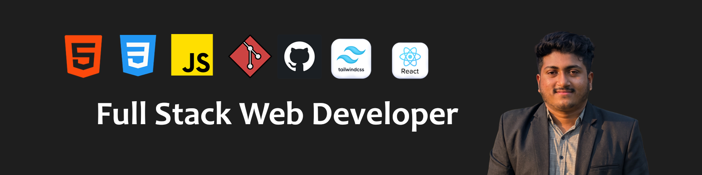

  

# 👋 Hi, I'm Sajal Biswas

### 🚀 Full Stack Web Developer

☕ Connect with me!
 

### 🚀 Full Stack Web Developer

I'm a Full Stack Web Developer from Bangladesh.  
I am passionate about building modern, responsive, and useful web applications.

## 👨‍💻 About Me

- 💻 Full Stack Web Developer
- 🌱 Currently learning and improving my web development skills
- 🚀 Building modern and responsive web applications
- 🎯 Focused on becoming a better developer every day
- 📚 Learning new technologies and best practices

### Things I code with

  
  
  
  
  
  
   
  
  
  

## 🛠️ Skills & Technologies

### Frontend

### Backend

### Database

### Tools

## 📊 GitHub Stats

## 💻 Most Used Languages

## 👀 Profile Views

## 🤝 Connect With Me

)
)

---

> 💡 "Code. Learn. Build. Repeat."

## 🔥 GitHub Streak

## 🚀 Featured Projects

### 🌐 Veltrio Digital
Digital Marketing Agency landing page built with WordPress and Elementor.

**Tech:** WordPress • Elementor

---

### 🛒 E-Commerce Website
Responsive e-commerce website project.

**Tech:** HTML • CSS • JavaScript

---

### 💻 More Projects Coming Soon...
